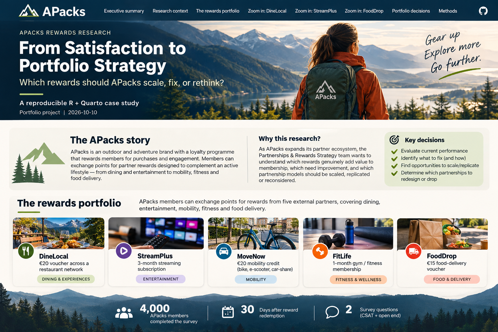

```{r}
#| include: false
source("R/00_setup.R")
source("R/01_helpers.R")
source("R/02_theme_dictionary.R")

survey <- read_csv("data/apacks_rewards_csat.csv", na=c("","NA"), show_col_types=FALSE) |>
  clean_names() |>
  mutate(
    partner=factor(partner,levels=partner_levels),
    country=factor(country),
    membership_tier=factor(membership_tier),
    redemption_channel=factor(redemption_channel),
    top2=csat_score>=4,
    bottom2=csat_score<=2,
    open_complete=!is.na(csat_open_end)
  )

partner_summary <- survey |>
  group_by(partner) |>
  summarise(n=n(),mean_csat=mean(csat_score),top2_success=sum(top2),
            top2=mean(top2),neutral=mean(csat_score==3),bottom2=mean(bottom2),
            open_completion=mean(open_complete),.groups="drop") |>
  mutate(top2_low=map2_dbl(top2_success,n,binom_ci_low),
         top2_high=map2_dbl(top2_success,n,binom_ci_high))

overall <- survey |> summarise(n=n(),mean_csat=mean(csat_score),top2=mean(top2),bottom2=mean(bottom2))

text_coded <- survey |>
  filter(open_complete) |>
  select(
    respondent_id, partner, country, csat_score, top2, bottom2,
    existing_streamplus_subscriber, csat_open_end
  ) |>
  crossing(theme_dictionary) |>
  filter(str_detect(str_to_lower(csat_open_end), regex(pattern, ignore_case=TRUE))) |>
  select(-pattern)
```

{fig-alt="Illustrative APacks outdoor rewards case study" width="100%"}

# The APacks story

::: {.callout-note icon=false}
## A fictional case built around a real insights challenge

**APacks** is a fictional outdoor and adventure brand. Its loyalty programme rewards purchases and engagement with points members can exchange for partner benefits—from dining and entertainment to mobility, fitness and food delivery.

As the ecosystem grows, the question changes from *“Do members like the rewards?”* to **“Where should we invest?”**
:::

## Why this research?

The **Partnerships & Rewards Strategy team** needs evidence for two jobs.

**Evaluate the current portfolio.** How satisfied are members? Where is friction occurring? Which problems are fixable?

**Shape the future portfolio.** Which reward models should be continued and scaled? Which successful mechanics might be replicated elsewhere? Which rewards should be fundamentally redesigned—or dropped?

::: {.columns}
::: {.column width="33%"}
### SCALE & REPLICATE
Learn what makes the strongest experiences work and use those characteristics to inspire adjacent partnerships.
:::
::: {.column width="33%"}
### FIX
Protect propositions that create value, but remove targeting, eligibility or journey friction.
:::
::: {.column width="33%"}
### RETHINK
Identify rewards where the basic experience is failing and decide whether to remediate, redesign or discontinue.
:::
:::

> **CSAT is one input, not the entire commercial decision.** A real portfolio review would also consider redemption, economics, reach, strategic fit and operational feasibility.

## The five rewards

| Partner | Reward | Role in members' lives |
|---|---|---|
| **DineLocal** | €20 restaurant-network voucher | Dining & experiences |
| **StreamPlus** | 3-month streaming subscription | Entertainment & downtime |
| **MoveNow** | €20 mobility credit | Car share, bike hire & e-scooters |
| **FitLife** | 1-month fitness membership | Fitness & wellbeing |
| **FoodDrop** | €15 food-delivery voucher | Convenient meals at home |

Thirty days after redemption, members receive a two-question survey: a **1–5 CSAT rating** followed by **“Please tell us why you gave this rating.”**

# Executive summary

Across **`r comma(overall$n)` simulated APacks members**, the five rewards require **five different management responses**. The topline tells APacks where to look; the diagnostic analysis explains what to do next.

::: {.callout-tip icon=false}
## The decision in one sentence
**Scale what creates reliable value. Retarget what is relevant only to some members. Monitor local variation. Repair journey friction. Rethink rewards that fail at the point of redemption.**
:::

```{r}
partner_summary |>
  mutate(decision=case_when(
    partner=="DineLocal"~"SCALE & REPLICATE",
    partner=="StreamPlus"~"FIX / RETARGET",
    partner=="MoveNow"~"CONTINUE / MONITOR",
    partner=="FitLife"~"IMPROVE & RETEST",
    partner=="FoodDrop"~"RETHINK")) |>
  select(partner,n,mean_csat,top2,bottom2,decision) |>
  gt() |>
  cols_label(
    partner="Reward", mean_csat="Mean CSAT", top2="Satisfied (4–5)",
    bottom2="Dissatisfied (1–2)", decision="Portfolio implication"
  ) |>
  fmt_number(columns=mean_csat,decimals=2) |>
  fmt_percent(columns=c(top2,bottom2),decimals=1)
```

# The portfolio landscape

```{r}
partner_summary |>
  ggplot(aes(x=top2,y=fct_reorder(partner,top2))) +
  geom_errorbarh(aes(xmin=top2_low,xmax=top2_high),height=.18,color="#0d2b3e") +
  geom_point(size=3.5,color="#6f8f3d") +
  scale_x_continuous(labels=percent_format(accuracy=1),limits=c(.20,.90)) +
  labs(
    x="Satisfied / very satisfied (95% CI)",y=NULL,
    title="The portfolio contains clear winners — and very different kinds of risk",
    subtitle="Top-2 Box satisfaction by reward"
  )
```

This chart is a **triage tool, not the conclusion**. DineLocal is the clear benchmark and FoodDrop the clear risk, but the middle of the portfolio cannot be managed from rank order alone. StreamPlus, MoveNow and FitLife have similar-looking toplines for **different reasons**.

# SCALE & REPLICATE — DineLocal

> **When a reward works this well, what should APacks learn from it—not just about this partner, but about the next partnership it should seek?**

DineLocal is the portfolio benchmark: **85.4%** of members are satisfied or very satisfied, while only **6.2%** are dissatisfied. The open ends help explain why the experience travels so well across the member base.

```{r}
dine <- survey |> filter(partner=="DineLocal")
dine_open_n <- dine |> filter(open_complete) |> nrow()

text_coded |>
  filter(
    partner=="DineLocal",
    theme %in% c("Ease / low friction","Usefulness / relevance","Choice / flexibility","Value")
  ) |>
  count(theme,name="mentions") |>
  mutate(pct_open=mentions/dine_open_n) |>
  ggplot(aes(pct_open,fct_reorder(theme,pct_open))) +
  geom_col(width=.62,fill="#6f8f3d") +
  geom_text(aes(label=percent(pct_open,accuracy=1)),hjust=-.15,fontface="bold") +
  scale_x_continuous(labels=percent_format(accuracy=1),limits=c(0,.38),expand=c(0,0)) +
  labs(
    x="Share of completed DineLocal open ends",y=NULL,
    title="DineLocal succeeds on more than satisfaction",
    subtitle="Members repeatedly describe an easy, useful, flexible and clearly valuable reward"
  ) +
  theme(panel.grid.major.y=element_blank())
```

::: {.callout-note icon=false}
## What APacks should replicate

The strategic opportunity is bigger than retaining DineLocal. The reward combines **clear value**, **low redemption friction**, **everyday relevance** and **choice**. Those characteristics give APacks a hypothesis for what to seek in adjacent experiential rewards—such as cafés, events, leisure or outdoor experiences.

The current study does **not** prove demand for those categories; it identifies a reward mechanic worth testing elsewhere.
:::

# FIX / RETARGET — StreamPlus

> **Is this a weak reward—or a strong reward being offered to the wrong people?**

StreamPlus looks mediocre in aggregate: **57.4%** satisfied and **30.5%** dissatisfied. But the average conceals the most important segmentation finding in the portfolio.

```{r}
stream <- survey |> filter(partner=="StreamPlus")

stream_segment_plot <- stream |>
  mutate(
    subscriber_group=if_else(
      existing_streamplus_subscriber=="Yes",
      "Existing subscriber",
      "Not already subscribed"
    ),
    experience=case_when(
      csat_score<=2 ~ "Dissatisfied (1–2)",
      csat_score==3 ~ "Neutral (3)",
      TRUE ~ "Satisfied (4–5)"
    ),
    experience=factor(
      experience,
      levels=c("Dissatisfied (1–2)","Neutral (3)","Satisfied (4–5)")
    )
  ) |>
  count(subscriber_group,experience) |>
  group_by(subscriber_group) |>
  mutate(pct=n/sum(n)) |>
  ungroup()

ggplot(
  stream_segment_plot,
  aes(x=pct,y=fct_rev(factor(subscriber_group)),fill=experience)
) +
  geom_col(width=.62) +
  geom_text(
    aes(label=if_else(pct>=.08,percent(pct,accuracy=1),"")),
    position=position_stack(vjust=.5),
    color="white",fontface="bold",size=4.2
  ) +
  scale_x_continuous(labels=percent_format(accuracy=1),expand=c(0,0)) +
  scale_fill_manual(values=c(
    "Dissatisfied (1–2)"="#B74D3E",
    "Neutral (3)"="#B9B2A3",
    "Satisfied (4–5)"="#557A46"
  )) +
  labs(
    x=NULL,y=NULL,fill=NULL,
    title="StreamPlus is a targeting problem, not a weak proposition",
    subtitle="Satisfaction changes dramatically depending on whether the member already subscribes"
  ) +
  theme(
    legend.position="bottom",
    panel.grid.major.y=element_blank(),
    panel.grid.minor=element_blank(),
    axis.text.y=element_text(face="bold",size=11)
  )
```

Among members **not already subscribed**, **83.1%** are satisfied and only **7.4%** dissatisfied. Among **existing subscribers**, satisfaction falls to **24.5%** and dissatisfaction rises to **60.2%**.

::: {.callout-note icon=false}
## What the segmentation changes

The management response changes from **“improve the reward”** to **“improve who receives it.”**

**CRM and Data Analytics** should help identify likely eligibility before the reward is surfaced. **Partnerships** should also explore an alternative benefit for members who already subscribe, so an otherwise strong proposition does not become exclusionary.
:::

```{r}
stream |>
  filter(open_complete,bottom2,existing_streamplus_subscriber=="Yes") |>
  distinct(csat_open_end,.keep_all=TRUE) |>
  select(csat_score,csat_open_end) |>
  slice_head(n=3) |>
  gt() |>
  cols_label(
    csat_score="CSAT",
    csat_open_end="Illustrative synthetic member comment"
  )
```

# CONTINUE / MONITOR — MoveNow

> **Is the reward healthy overall—or is the aggregate hiding markets where the proposition is materially weaker?**

MoveNow sits in the healthier middle of the portfolio, with **63.2%** satisfied. The key issue is not broad rejection: it is **uneven local availability**.

```{r}
move <- survey |> filter(partner=="MoveNow")

move_market <- move |>
  group_by(country) |>
  summarise(
    n=n(),
    satisfied=sum(top2),
    top2=mean(top2),
    .groups="drop"
  )

ggplot(move_market,aes(top2,fct_reorder(country,top2))) +
  geom_col(width=.58,fill="#3f6f8f") +
  geom_text(
    aes(label=percent(top2,accuracy=1)),
    hjust=-.18,fontface="bold"
  ) +
  scale_x_continuous(labels=percent_format(accuracy=1),limits=c(0,.78),expand=c(0,0)) +
  labs(
    x="Satisfied / very satisfied",y=NULL,
    title="MoveNow's experience varies meaningfully by market",
    subtitle="The portfolio average masks a 17-point satisfaction gap between France and Italy"
  ) +
  theme(panel.grid.major.y=element_blank())
```

The pattern in the comments points in the same direction. Among completed MoveNow open ends, **availability / coverage** is mentioned in roughly **11–12%** of comments in Germany and France, rising to **21%** in Spain and **32%** in Italy.

::: {.callout-note icon=false}
## What APacks should do

Keep the reward, but manage it as a **market-sensitive proposition** rather than assuming the same experience everywhere. **Market Membership Leads, Partnerships and local analytics teams** should identify whether coverage, participating locations or partner supply explain the weaker markets before APacks considers broader expansion.
:::

# IMPROVE & RETEST — FitLife

> **Does FitLife lack member value—or is friction around activation and access suppressing a proposition that can work?**

FitLife is genuinely mixed: **52.6%** satisfied and **24.5%** dissatisfied. Unlike StreamPlus, there is no single eligibility split that explains the result. The open ends point instead to a **bundle of journey frictions**.

```{r}
fit <- survey |> filter(partner=="FitLife")
fit_diss_open_n <- fit |> filter(open_complete,bottom2) |> nrow()

text_coded |>
  filter(
    partner=="FitLife",
    bottom2,
    theme %in% c(
      "Availability / coverage",
      "Activation friction",
      "Auto-renewal concern",
      "Support problem"
    )
  ) |>
  count(theme,name="mentions") |>
  mutate(pct_open=mentions/fit_diss_open_n) |>
  ggplot(aes(pct_open,fct_reorder(theme,pct_open))) +
  geom_col(width=.62,fill="#C47A32") +
  geom_text(aes(label=percent(pct_open,accuracy=1)),hjust=-.15,fontface="bold") +
  scale_x_continuous(labels=percent_format(accuracy=1),limits=c(0,.50),expand=c(0,0)) +
  labs(
    x="Share of dissatisfied FitLife open ends",y=NULL,
    title="FitLife's problem is the journey around the reward",
    subtitle="Coverage, activation and auto-renewal concerns dominate dissatisfied feedback"
  ) +
  theme(panel.grid.major.y=element_blank())
```

There is also evidence that the underlying proposition can create value: among **satisfied FitLife commenters**, usefulness/relevance, value and ease are each mentioned by roughly **four in ten**. The safer interpretation is therefore not “members do not want fitness rewards,” but **“the current journey makes the value harder to realise.”**

::: {.callout-note icon=false}
## What APacks should do

Work with **Membership Experience, CRM, Market Membership Leads and the partner** to simplify activation, make renewal terms explicit and improve local access. Then **remeasure**. FitLife should earn further investment by showing that those fixes move satisfaction—not simply by changing the offer headline.
:::

# RETHINK — FoodDrop

> **Is there a valuable proposition hidden underneath the low score, or is the basic experience failing?**

FoodDrop is the clearest portfolio risk: only **26.0%** are satisfied, while **54.3%** are dissatisfied. The qualitative evidence points to problems at the heart of redemption rather than a narrow audience mismatch.

```{r}
food <- survey |> filter(partner=="FoodDrop")
food_diss_open_n <- food |> filter(open_complete,bottom2) |> nrow()

text_coded |>
  filter(
    partner=="FoodDrop",
    bottom2,
    theme %in% c("Voucher reliability","Minimum-spend friction","Support problem")
  ) |>
  count(theme,name="mentions") |>
  mutate(pct_open=mentions/food_diss_open_n) |>
  ggplot(aes(pct_open,fct_reorder(theme,pct_open))) +
  geom_col(width=.62,fill="#B74D3E") +
  geom_text(aes(label=percent(pct_open,accuracy=1)),hjust=-.15,fontface="bold") +
  scale_x_continuous(labels=percent_format(accuracy=1),limits=c(0,.57),expand=c(0,0)) +
  labs(
    x="Share of dissatisfied FoodDrop open ends",y=NULL,
    title="FoodDrop fails at the point where promised value must become real",
    subtitle="Voucher reliability, minimum-spend rules and support dominate dissatisfied feedback"
  ) +
  theme(panel.grid.major.y=element_blank())
```

```{r}
food |>
  filter(open_complete,bottom2) |>
  distinct(csat_open_end,.keep_all=TRUE) |>
  select(csat_score,csat_open_end) |>
  slice_head(n=4) |>
  gt() |>
  cols_label(
    csat_score="CSAT",
    csat_open_end="Illustrative synthetic member comment"
  )
```

::: {.callout-note icon=false}
## What APacks should do

This is not a reward to optimise around the edges. **Partnerships and Partner Operations** should require remediation of voucher reliability and clearer offer terms. If the partner cannot fix those basics, APacks should reconsider whether the reward belongs in the portfolio.
:::

# Portfolio decisions

The five analyses lead to **five distinct actions, owners and follow-up questions**. The value of the programme is not simply ranking partners—it is diagnosing the mechanism behind each score.

```{r}
portfolio_actions <- tribble(
  ~Reward, ~Decision, ~Evidence, ~`Primary action`, ~`Teams / stakeholders to involve`,
  "DineLocal", "SCALE & REPLICATE",
  "85% satisfied; members repeatedly cite ease, usefulness, choice and value",
  "Continue; codify the successful mechanics and test them in adjacent experiential categories.",
  "Partnerships & Rewards Strategy; Category / Business Development; Market Membership Leads",
  "MoveNow", "CONTINUE / MONITOR",
  "63% satisfied overall, but satisfaction ranges from 70% in FR to 53% in IT",
  "Maintain the reward while diagnosing local coverage and partner availability in weaker markets.",
  "Market Membership Leads; Partnerships; Local Market Analytics",
  "StreamPlus", "FIX / RETARGET",
  "83% satisfied among non-subscribers vs 25% among existing subscribers",
  "Improve eligibility targeting and negotiate an alternative benefit for existing subscribers.",
  "CRM; Data Analytics; Partnerships; Lifecycle / Membership",
  "FitLife", "IMPROVE & RETEST",
  "Mixed topline; dissatisfied feedback centres on access, activation and renewal friction",
  "Fix the journey and remeasure before deciding whether the reward merits greater investment.",
  "Membership Experience; CRM; Market Membership Leads; Partnerships",
  "FoodDrop", "RETHINK",
  "54% dissatisfied; voucher reliability and minimum-spend friction dominate negative feedback",
  "Require major remediation; reconsider the reward if the partner cannot fix the fundamentals.",
  "Partnerships; Partner Operations; Customer Care; Rewards Strategy"
)

portfolio_actions |>
  gt() |>
  cols_width(
    Reward ~ px(105),
    Decision ~ px(145),
    Evidence ~ px(245),
    `Primary action` ~ px(310),
    `Teams / stakeholders to involve` ~ px(255)
  ) |>
  tab_header(
    title=md("**From research finding to portfolio action**"),
    subtitle="The recommendation changes with the mechanism behind the score"
  ) |>
  tab_style(
    style=cell_text(weight="bold"),
    locations=cells_body(columns=c(Reward,Decision))
  ) |>
  tab_options(
    table.font.size=px(14),
    data_row.padding=px(10),
    heading.align="left"
  )
```

## The bigger strategic opportunity

::: {.callout-tip icon=false}
### Turn one CSAT study into a reward-design playbook

Taken together, the five rewards begin to define **what APacks should look for when designing, evaluating or negotiating partner rewards**.

**Make the value obvious.** DineLocal shows the strength of an easy-to-understand reward with flexible, relevant value.

**Match the reward to the member.** StreamPlus shows that a strong proposition can become a poor experience when eligibility is ignored.

**Design for the market, not just the global proposition.** MoveNow shows how local coverage can materially change the same reward.

**Treat the journey as part of the reward.** FitLife shows that activation, access and renewal mechanics can suppress an otherwise useful proposition.

**Protect the basics.** FoodDrop shows that no amount of strategic fit compensates for unreliable redemption or unexpected restrictions.
:::

## From measurement to organisational capability

The longer-term opportunity is to turn these principles into a **shared evidence base for reward strategy**.

That gives **Partnerships** clearer criteria when evaluating and negotiating new offers. It gives **Markets and Membership Leads** a framework for judging whether a reward will work locally. It gives **CRM and Data Analytics** a clearer role in matching rewards to eligible and relevant audiences. It gives **Membership Experience and Operations** concrete experience standards to protect. And it gives **senior strategic leaders** a more consistent way to compare partnership opportunities beyond commercial terms alone.

In that sense, the value of the research is not simply deciding what to do with today's five partners. It is beginning to define the characteristics APacks should seek—and the questions it should ask—whenever it considers the **next reward**.
